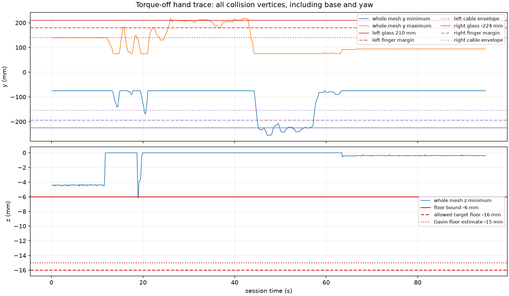
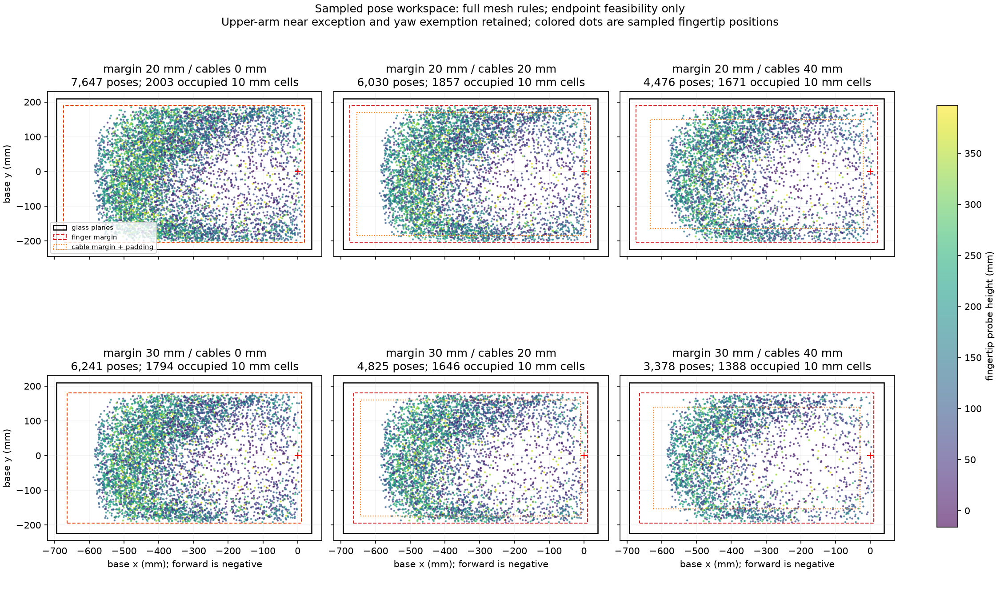

# Aquarium keep-out guard: offline validation

No unsafe granted segment was found. The independent check covered **562,508 poses** at joint intervals of at most **0.05°**. The worst checked slack was **1.06663368e-05 mm**. This is numerical evidence for the shipped mesh model, not physical commissioning. The main operational problem is speed: a wall clamp can exceed both the **50 ms** policy-row budget and the **20 ms** bus-write budget. [Adversarial evidence](adversarial_summary.json), [directed evidence](directed_summary.json), [sim segment evidence](sim_independent_verification.json), [timing](benchmark.json).

The task serves goal B3: Dream-1 on the real waterproof arm. Gavin asked, “can we now build a bounding box to run dream1?” and allowed contact only with the aquarium floor. This work used saved files and pure geometry. It made no hardware connection or policy call. The guard, config and tests were left unchanged. No commit or push was made. [Scope and file checks](verification.json), [project intent](../../../../docs/viscous-haptics.md#aquarium-glass-protection-and-the-tank-measurement-2026-11-07).

## Numbers for the tank

The shipped planes are x **−694..40 mm**, y **−224..210 mm**, floor **−6 mm**, and rim **427 mm**. Fingers keep **30 mm** from walls and rim. Other moving links usually keep **70 mm**, including **40 mm** for cables. Targets may reach **z = −16 mm** because floor press is **10 mm**. `yaw_link` is exempt. The upper-arm near face has **0 mm** margin and padding. These exceptions remain in every variant. [Shipped config](../../../../configs/viscous/environments/aquarium_landen_75/keepout_viscous_waterproof_01.json).

The hand trace has **857 readings**, from **0.122 s** to **94.807 s**. The shipped guard accepts **540** and fails **317**. Zero margin and zero padding accept **725** and fail **132**. That variant retains floor press and the yaw exemption. Literal raw-plane crossings are listed below; floor press is removed only for that crossing calculation. Per-link/face counts and worst slacks are in [trace_summary.json](trace_summary.json).

| Raw face | Outside readings | Worst raw slack (mm) | Session time ranges (s) |
| --- | --- | --- | --- |
| near | 0 | 3.077 | none |
| far | 0 | 122.275 | none |
| left | 54 | -8.503 | 25.893–26.221, 26.658–26.658, 32.001–34.308, 39.765–40.423, 40.868–42.954 |
| right | 78 | -31.978 | 45.266–48.574, 49.959–51.599, 52.701–55.237, 55.679–56.332 |
| floor | 1 | -0.164 | 18.898–18.898 |
| rim | 0 | 60.833 | none |

The whole mesh reaches **y = −255.978..218.503 mm** and **z minimum = −6.164 mm**. This reproduces the expected **8.503 mm** +y crossing and **31.978 mm** −y crossing. The trace records hand motion with a sliding base; these crossings do not show that the guard granted unsafe motion. [Trace series](trace_series.json), [trace summary](trace_summary.json).

## Recorded Dream-1 chunks

**Assumption:** the real executor presents a virtual base turned **180°**. Forward is therefore **−x** in `base_link`. Conversion is `motor_deg = (URDF_deg − offset_deg) / sign`, then **+180°** on shoulder_pan. Grip fraction **0** maps to **−2.92°** and **1** to **−115°**. z is unchanged. The motor map has a negative wrist-yaw sign. These are replay assumptions, not verified executor behavior. [Replay assumptions and sources](sim_summary.json), [motor map](../../../../configs/viscous/model/motor_to_urdf.json).

The inventory selects **110 primary Viscous runs**, with both arms checked separately: **202,944 policy rows**. Exact executor targets come from saved `execution` fields or older `trajectory.json` commanded rows. Archived copies, empty files and other robot models are excluded with reasons. Dry, scripted and replay sources are included and retain their path labels. [Inventory](sim_inventory.json), [all per-run numbers](sim_runs.md), [source hashes and detailed metrics](sim_summary.json).

All **220 first poses** fail the start gate: **176** at forearm/near and **44** at forearm/rim. Each replay starts at the tests’ REST pose and requests a direct approach to row one in increments of at most **1°**. Only granted targets advance. This approach stalls at the rim. Policy totals are **0 ok**, **1,086 clamped**, **201,858 rejected**. The keep-out decisions bind forearm/rim; the remaining refusals come from the jump filter. The longest non-ok stretch is **1440 rows = 72.0 s**. These counts describe this required REST-and-ramp experiment. They do not prove that every later requested pose is unreachable by every possible approach. [Start gates, approach targets, reasons and counts](sim_summary.json).

The tabletop hand paths do **not** all fit. Only **125/218 arm streams** keep their full raw EEF request extent inside the raw six planes, even before applying a margin or checking the rest of the arm. Important left-arm examples follow. [All xyz extents and plane slacks](sim_summary.json), [readable per-run paths](sim_runs.md).

| Run: left arm | Policy rows | Raw EEF x; y; z extents (mm) | Past +y plane (mm) |
| --- | --- | --- | --- |
| viscous_apple_makerwrist_live1 | 960 rejected | -282.7..-70.0; -3.9..319.8; 9.6..152.2 | 109.83 |
| viscous_box_makerwrist_live1 | 960 rejected | -280.4..-99.5; -12.6..262.0; 15.3..151.7 | 52.01 |
| sweep/B0/apple/ep_00 | 528 rejected | -295.7..-96.0; -3.9..302.2; 31.2..182.0 | 92.21 |
| sweep/B0/box/ep_00 | 1152 rejected | -230.7..-86.0; -9.7..214.0; 10.4..173.9 | 3.99 |

Each run’s ok/clamped/rejected count, binding face, longest non-ok stretch, joint and probe error median/maximum, and timing mean/p99/maximum are in [sim_runs.md](sim_runs.md). The JSON additionally has each motor’s error, joint L2 error, start-gate slack and requested probe extents. Raw Dream EEF requests and FK fingertip probes use different tool points; they are reported separately. [Detailed metrics](sim_summary.json).

## Adversarial verification

The campaigns issue **21,261 requests**: **5,812 ok**, **531 clamped**, **14,918 rejected**. They include uniform in-limit targets, local **±3° / ±19°** targets, J1 wraps of **±360° / ±720°**, IK-style flips, **0.25°** ramps, **0.02°** creep streams, floor dives, near-wall elbow requests, rim requests and opening fingers at a wall. [Random and creep campaigns](adversarial_summary.json), [directed campaigns](directed_summary.json).

For every ok or clamped segment, the checker calls only `tank_geometry.forward_kinematics` for transforms. It transforms every collision vertex into world coordinates. It independently reads margin, padding, plane and exemption rules from the config. It samples straight joint space at **≤0.05°**, including both endpoints, and compares those vertices with each plane. It never calls the guard’s clearance code for the verification verdict. The epsilon is **0.0000001 mm**. All sim policy grants and synthetic approach grants receive the same independent check: **25,019 segments**, **430,858 sampled poses**. [Checker source](../../tank_guard_validation/validate.py), [sim checks](sim_independent_verification.json).

Directed tests bind near, left, right, floor and rim. Opening the fingers binds `gripper_left` against the right wall. Some long opening requests clamp only because the sweep proof reserves extra clearance; their slower ramps can remain clear. The folded-back near-wall attempt stops at wrist-pitch/rim before reaching the near plane. No far-face binding request was found. The closest sampled far clearance in **24,000** search poses was **74.44 mm**, including the configured requirement. This search is not a proof of the arm’s global reach. [Directed details](directed_summary.json), [pose search](pose_pool.json).

On **3,000 random steps**, the motion bound covers true endpoint vertex displacement within the **0.0000001 mm** epsilon. The smallest bound-minus-displacement value is **-2.31e-13 mm**, a floating-point rounding difference. No unsafe reproduction or correctness patch is needed for the tested inputs. [Motion-bound evidence](adversarial_summary.json).

## Room left by the box

The map uses **192,000 identical candidate poses** for all six settings. Half sample every motor uniformly within limits. Half concentrate J1 between **130°** and **187.529°**. Full collision meshes and all shipped exceptions are checked. This is a sampled endpoint map. It does not show that an allowed point is connected to REST, or give an exhaustive workspace volume. [Method and bins](workspace_summary.json).

| Margin (mm) | Cable padding (mm) | Allowed sampled poses | Fraction of candidates | Occupied 10 mm xy cells |
| --- | --- | --- | --- | --- |
| 20 | 0 | 7,647 | 3.983% | 2003 |
| 20 | 20 | 6,030 | 3.141% | 1857 |
| 20 | 40 | 4,476 | 2.331% | 1671 |
| 30 | 0 | 6,241 | 3.251% | 1794 |
| 30 | 20 | 4,825 | 2.513% | 1646 |
| 30 | 40 | 3,378 | 1.759% | 1388 |

At **30 mm** margin, changing cable padding from **40 mm** to **20 mm** adds **42.8%** more accepted sampled poses. Changing it to **0 mm** adds **84.8%**. Occupied xy cells rise from **1,388** to **1,646 / 1,794**. Each cell is **1 cm²**; this is sparse projected occupancy, not a measured floor area. Cable measurement could recover useful room. These variants are sensitivity tests, not permission to use zero padding. [Same-candidate comparison](workspace_summary.json).

Sampled J1 angle envelopes for the forward branch (**J1 ≥90°**) follow. Reach is horizontal probe distance from J1; height is probe z. Cells show the outer edges of occupied **5°** bins, then the sample count in parentheses. A minimum-to-maximum envelope can contain holes. Full **5° J1 histograms** for every **50 mm reach × 50 mm height** bin are in [workspace_summary.json](workspace_summary.json), including the separate near-zero-angle branch.

| Margin / padding (mm) | Height (mm) | Reach 200..250 mm | Reach 400..450 mm | Reach 550..600 mm |
| --- | --- | --- | --- | --- |
| 20 / 0 | 0..50 | 150..187.5 (119) | 150..187.5 (99) | 165..187.5 (24) |
| 20 / 0 | 150..200 | 150..187.5 (65) | 150..187.5 (184) | 155..187.5 (65) |
| 20 / 20 | 0..50 | 150..187.5 (101) | 150..187.5 (88) | 165..187.5 (23) |
| 20 / 20 | 150..200 | 150..187.5 (43) | 150..187.5 (142) | 155..187.5 (62) |
| 20 / 40 | 0..50 | 150..187.5 (81) | 150..187.5 (78) | 165..187.5 (22) |
| 20 / 40 | 150..200 | 150..187.5 (24) | 155..187.5 (98) | 160..187.5 (53) |
| 30 / 0 | 0..50 | 150..187.5 (102) | 150..187.5 (86) | 165..187.5 (24) |
| 30 / 0 | 150..200 | 150..187.5 (36) | 150..187.5 (149) | 155..187.5 (62) |
| 30 / 20 | 0..50 | 150..187.5 (86) | 150..187.5 (75) | 165..187.5 (23) |
| 30 / 20 | 150..200 | 150..187.5 (22) | 155..187.5 (105) | 155..187.5 (57) |
| 30 / 40 | 0..50 | 150..187.5 (67) | 150..187.5 (61) | 165..187.5 (19) |
| 30 / 40 | 150..200 | 150..187.5 (12) | 155..187.5 (71) | 160..187.5 (48) |

## Timing and proposed changes

The isolated benchmark runs **10 warmups + 150 repeats** per case. It times the guard step, without policy inference, FK reporting or the independent checker. A policy row has **50 ms** at **20 Hz**. A bus write has about **20 ms** at **50 Hz**. [Benchmark](benchmark.json).

| Request | Decision | Mean (ms) | p99 (ms) | Maximum (ms) |
| --- | --- | --- | --- | --- |
| hold | ok | 1.445 | 1.521 | 1.530 |
| small_1deg | ok | 2.396 | 2.475 | 2.666 |
| multi_joint_10deg | ok | 33.911 | 35.307 | 36.800 |
| wall_clamp | clamped | 257.180 | 262.510 | 263.619 |
| jump | rejected | 0.002 | 0.002 | 0.002 |

A **10°** move on three joints can exceed the bus-write budget. The **19° J1 wall clamp** exceeds both budgets. The profile performs **26,950 pose checks** and **750 segment checks** for **50** clamp requests. Most time goes to mesh min/max reductions, then vertex projection and FK. The **14** bisection rounds repeat many checks. Fast jump rejections in the saved-run statistics hide this worst case. [Profile](profile_wall_clamp.json), [per-run timing](sim_summary.json).

Propose precomputing each link’s convex-hull vertex set and skipping fully exempt links before projection. A plane’s min/max is unchanged by this reduction. That would reduce vertices processed here from **9,059** to **2,794**. Cache or reuse subdivisions during bisection, and consider per-link motion bounds. Preserve the sweep proof and independently recheck every change. None of these changes was applied, and no speed-up factor is claimed. [Vertex counts](performance_proposal.json).

## Reproduce and limits

Use `PYTHONPATH=.` and `~/Documents/makermodslab-viscous/.venv/bin/python` from this worktree. Run `scripts/viscous-dream1/tank_guard_validation/validate.py` with stages `trace`, `sims`, `adversarial`, `workspace`, then run `directed.py`, `verify_sims.py`, and the `benchmark` stage without competing validation workers. Run `hull_counts.py` for the proposed reduction counts, then finish with `report.py`. Default workers are **12**. All data are read from saved files; none of these scripts imports Dream or a hardware driver. Plotting packages were installed only under `/tmp/tankbox/plot-deps` from the local offline wheel cache. Hull counting used SciPy under `/tmp/tankbox/analysis-deps`. The shared environment was unchanged. [Commands, versions, hashes and checks](verification.json).

The existing guard suite passes **15/15**. This run does not validate unmodelled cables, base motion, physical encoder signs, controller tracking or a downstream limiter that bends a straight joint segment. The documented sliding base must be fixed and the estimated near wall measured before a powered trial. The test’s virtual-base assumption also needs executor validation. [Checks](verification.json), [guard path contract](../../../../makermodslab/tank_guard.py), [measurement record](../../../../docs/viscous-haptics.md#aquarium-glass-protection-and-the-tank-measurement-2026-11-07).
