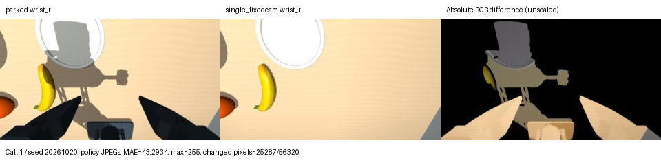

# Parked-arm isolation: Dream-1 apple task

Zero-shot `dreamlabs/dream-1-beta`, vision mode, paired seeds 20261020–20261025, ±2 cm x/y jitter, 18-call episode cap. Success requires the existing resting-at-target check at two consecutive call endpoints; medians include the confirming call. Grasp means >3 cm lift. Earlier four rows are reused measurements; only the last two are new.

| Configuration | Episodes | Successes | Grasps | Median calls to success | Finger/table contact rows |
|---|---:|---:|---:|---:|---:|
| B0 | 6 | 6 | 6 | 13.5 | 5/3744 (0.1%) |
| single | 6 | 2 | 4 | 14.0 | 0/4800 (0.0%) |
| single_copy | 6 | 2 | 2 | 15.0 | 1/4896 (0.0%) |
| parked | 6 | 6 | 6 | 9.0 | 99/2640 (3.8%) |
| single_fixedcam | 6 | 1 | 1 | 12 | 13/4896 (0.3%) |
| parked_blind | 6 | 4 | 4 | 9.5 | 102/3600 (2.8%) |

Paired outcomes, in column order **B0 / single / single_copy / parked / single_fixedcam / parked_blind**; W/L followed by billed calls:

- **20261020**: W/11 / L/18 / L/18 / W/11 / L/18 / L/18.
- **20261021**: W/14 / L/18 / L/18 / W/10 / L/18 / W/12.
- **20261022**: W/13 / L/18 / L/18 / W/8 / W/12 / L/18.
- **20261023**: W/7 / W/16 / W/18 / W/9 / L/18 / W/9.
- **20261024**: W/15 / L/18 / W/12 / W/9 / L/18 / W/8.
- **20261025**: W/18 / W/12 / L/18 / W/8 / L/18 / W/10.

**Result: the visible parked-arm condition helps, but neither isolated control reproduces parked’s 6/6.** `parked_blind` is 4/6 versus `single`’s 2/6: it rescues seeds 20261021 and 20261024 and retains both single successes. Restoring the real right wrist view to parked gives 6/6, rescuing 20261020 and 20261022. `single_fixedcam` is 1/6: it rescues 20261022 but loses single’s successes on 20261023 and 20261025. A second real workspace view alone did not fix one-arm performance here.

Interpretation: (a), the visible-arm condition, accounts for part of the improvement; (b), the real wrist view, adds benefit **within the parked scene**. The combined input performed best. This supports a joint visual-context explanation, not a clean claim that either factor alone explains parked. Removing the arm also removes its wrist-view fingers and shadows, so fixedcam does not isolate workspace information from that foreground context. Six paired scene seeds, with model outputs not held deterministic, do not establish a universal requirement or reveal the model’s internal reason.

Real bench: a cheap fixed camera at this right-wrist pose **is not a validated standalone fix**. A camera plus a visible parked-arm dummy is a plausible next test, not a measured solution; even reproducing the wrist-view finger foreground might matter. Keep the right rest/open state and discard right actions as tested. No real-bench effectiveness was measured.

Physical-assistance check (measured, no inference): replaying all six parked and all six blind episodes and inspecting contacts after every 1 ms physics step found **0 / 0 right-arm contact steps**, respectively. The parked body did not contact the apple, working arm, or table in these runs. [Replay audit](sweep/isolate_validation/parked_physical_contacts.json).

Controls measured: `single_fixedcam` has no right body tree in any view; its world-fixed camera matches the parked rest/open camera position and orientation (checked to 2×10⁻¹⁵), FOV **77.2°**, and **640×360** render aspect. World position is (-0.305000, -0.014022, 0.959522) m. Right state is exactly the measured parked rest/open vector; right chunks are ignored. `parked_blind` keeps parked physics, geometry and state, replacing every right frame with black. Its maximum joint deviation was zero.

The fixed view **lacks the parked gripper fingers and arm shadows**. The views are therefore geometrically matched, not pixel-identical. At call 1 / seed 20261020, decoded policy JPEGs (320×176) differ in **25287/56320 pixels (44.9%)**, mean absolute RGB difference **43.29/255**, maximum 255. Raw render difference: 68898/230400 pixels, mean 42.93/255, maximum 245. Absolute differences are unscaled in the right panel.

No-call call-1 contact sheets: [single_fixedcam](sweep/dry/single_fixedcam/apple/ep_00/contact_sheet.jpg), [parked_blind](sweep/dry/parked_blind/apple/ep_00/contact_sheet.jpg). Both completed 864 dry rows. All existing no-call checks passed: 32 legacy physics/policy combinations plus unchanged `single_copy`/`parked`, sweep geometry/FK/clamp and durable-budget checks, fake-client stop/resume checks, all 18 legacy modes, and parked contact-force hold. Legacy image rounding differed by at most 1 intensity level. New checks verify matched physics for single/fixed and parked/blind under identical commands, exact right state, ignored chunks, black JPEG windows, fixed camera pose and the task budget ceiling. [Checks, console logs and audit](sweep/isolate_validation/).

Accounting: **177 billed calls used of 220 allowed**, 0 unbilled `pool_warming` refusals, 0 uncertain calls. Ledger **1029 → 1206 used**, cap unchanged at **1312**; **106 calls remain**. All 12 requested episodes ran; full-cap planning needed 216 calls. Crash-safe accounting and the global runner lock remain in place.

Representative videos (good/bad use the automated result; none means no episode had that outcome):

- **single_fixedcam**: good [runs/sweep/single_fixedcam/apple/ep_02/run.mp4](/home/gavin/dreamtrial/viscous_sim/runs/sweep/single_fixedcam/apple/ep_02/run.mp4); bad [runs/sweep/single_fixedcam/apple/ep_00/run.mp4](/home/gavin/dreamtrial/viscous_sim/runs/sweep/single_fixedcam/apple/ep_00/run.mp4).
- **parked_blind**: good [runs/sweep/parked_blind/apple/ep_01/run.mp4](/home/gavin/dreamtrial/viscous_sim/runs/sweep/parked_blind/apple/ep_01/run.mp4); bad [runs/sweep/parked_blind/apple/ep_00/run.mp4](/home/gavin/dreamtrial/viscous_sim/runs/sweep/parked_blind/apple/ep_00/run.mp4).

Files changed: `sweep.py`, `sweep_scene.py`, `SWEEP_README.md`, `runs/sweep/ledger.json`. Added: `onearm_isolate_check.py`, `onearm_isolate_sweep.py`, `onearm_isolate_report.py`, `onearm_isolate_contacts.py`, this report, `runs/sweep/isolate_stages.json`, `runs/sweep/isolate_live.console.log`, `runs/sweep/isolate_validation/`, and the two new configurations’ live/dry episode and summary folders. Existing no-call validation artifacts were refreshed. Protected arm JSON hashes are unchanged. Episode folders contain only `log.json`, `chunks.jsonl`, `run.mp4`, and a contact sheet for episode 0.
